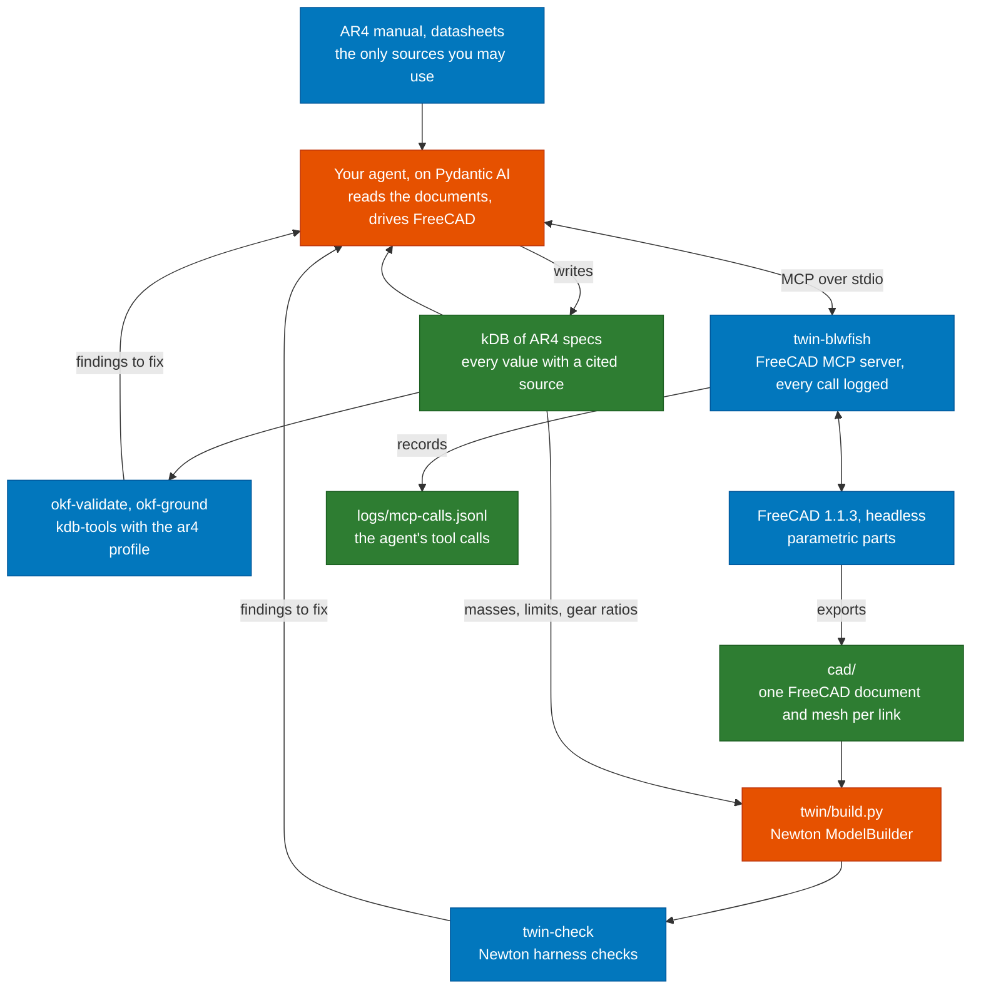

# AR4 digital twin

Student project for Robotics. You build a simulation twin of the Annin Robotics AR4 arm from
its documents alone: the manual, the motor and gearbox datasheets, Annin's spreadsheets, and
anything else your agent can find and cite. Your agent reads the documents into a kDB (Knowledge
DB) in which every number cites the sentence or spreadsheet cell that states it. It then models
each link in FreeCAD through MCP from those numbers. You assemble the links into a Newton model,
and the model has to pass the checks in this repository. The project page on aegean.ai
describes the task and how it is graded.

This repository holds the environment, a starter for your agent, and the tools that check your
work. The course runs the same tools at grading time. The kDB tools are
[kdb-tools](https://github.com/aegean-ai/kdb-tools), shared with the Introduction to AI project;
this repository adds their `ar4` profile.

## Where the tools fit

Orange boxes are what you build. Blue boxes come from the course. Green boxes are what you
submit, along with your code.



The public AR4 URDF and Annin's CAD files are not sources for this project. Your geometry comes
from the dimensions in the documents, and your masses come from material densities and datasheets.

## Models and agents you may use

You build the agent yourself, in Python, with Pydantic AI. That agent is what this project is
about, so no other agent may do its work. Commercial agent products and hosted agent services,
such as the ChatGPT, Claude or Gemini apps, Claude Code or a hosted agent platform, are not
accepted, and neither is a framework that runs its own agent to write the kDB or drive FreeCAD.

The model behind your agent can come from one of three places:

1. A local OpenAI-compatible server with an open-weight model, such as Ollama, llama.cpp, vLLM,
   SGLang or LM Studio.
2. A free model on [OpenRouter](https://openrouter.ai/models), whose model ids end in `:free`.
   Free models are rate limited, so your runs are slower.
3. A paid model on OpenRouter, with a strict credit limit set on your API key before you start.

No other hosted model API is allowed. Keep your OpenRouter key in an environment variable and
never in a file you commit; the starter reads it from the variable named in `kdb.toml`.

## The kDB

The kDB is an OKF bundle in `kdb/`. Put the documents under `kdb/documents/` and the highlighted
copies of the PDFs under `kdb/annotated/`. Each part of the arm gets one page, and each page
lists its numbers under `quantities`:

```yaml
type: Joint
title: J2
parent: /links/link-1.md
child: /links/link-2.md
quantities:
  upper_limit: {value: 90, unit: deg, source: manual-p37-2}
  velocity_limit: {value: 180, unit: deg/s, formula: "6 * /motors/j2.md#max_speed / /gearboxes/j2.md#ratio"}
```

A quantity cites a source on its page or gives a formula over other quantities. A source is a
sentence in a PDF, or a cell in a spreadsheet, cited by file, sheet and cell:

```yaml
sources:
  - {id: annin-dh-c2, resource: /documents/ar4-dh.xlsx, sheet: DH, cell: C2, value: "169.77"}
```

The `ar4` profile checks the pages. Every quantity needs a number, a unit from
`twin_tools.units` and either a source on the page or a formula. A formula is recomputed from
the values it names and must give the stated value. A Joint needs its two limits, a velocity
limit and an effort limit, and must connect two Link pages. A Link names its Material page, a
Material needs its density and a Gearbox its ratio. `okf-validate kdb` runs these rules with the
core kDB rules, and `okf-ground kdb` checks every source against its document.

`twin/build.py` reads its numbers with `twin_tools.kdb.si`, which converts them to SI units:

```python
from twin_tools.kdb import si
upper = si("joints/j2.md", "upper_limit")   # 90 deg on the page, 1.5708 rad here
```

## Tools

| Tool | What it does |
|---|---|
| `twin-blwfish` | Starts the [blwfish FreeCAD MCP server](https://github.com/blwfish/freecad-mcp) (v8.4.0) on stdio behind the call logger. Point your agent's MCP configuration at it. |
| `twin-mcp-log` | `run` logs every message between an agent and any stdio MCP server. `summary` lists the tool calls in a log and marks which ones failed, including failures the server reports as successes. Both exit 2 when they cannot run. |
| `twin-check` | Loads `twin/build.py`, builds the Newton model and checks it: every link has mass, every joint has limits, an effort limit and a velocity limit, every one of those values and every shape density was read from the kDB, and the arm released at rest under gravity stays finite and inside its limits. |
| `okf-validate`, `okf-ground` | The kdb-tools checks, with the `ar4` profile's rules. |

Newton accepts a joint with no limits and a link with no mass without complaint. It fills in
limits of 1e10 and effort and velocity limits of 1e6, gives an empty link a mass of 0 and a
shape with no density 1000 kg/m³. `twin-check` reports each of these. It also reports any limit,
density or mass that `build.py` typed in instead of reading from the kDB with
`twin_tools.kdb.si`. Use `--no-trace` while you develop, before your kDB has the values.

## Set up

You need Docker. Build the project image once, from the repository root:

```bash
docker build -f docker/Dockerfile -t ar4-twin .
```

The image holds FreeCAD 1.1.3, the blwfish server, Newton 1.7.0 and these tools, all at pinned
versions. `docker/run.sh` runs any command in it with the repository mounted at `/work`. Files the
tools write stay in your checkout: the container's home directory is `.home/` and logs go to
`logs/`, and git ignores both.

## Run

Check your twin:

```bash
docker/run.sh twin-check twin/build.py
docker/run.sh twin-check twin/build.py --json   # a report your agent can read
```

The exit status is 0 when there are no errors, 1 when there are errors and 2 when the tool could
not run.

Check the kDB:

```bash
docker/run.sh okf-validate kdb
docker/run.sh okf-ground kdb
```

Start your agent from the starter in `starter/`, which runs on your machine with uv and starts
the FreeCAD server through `docker/run.sh twin-blwfish`. Its README says what it already does
and what is yours:

```bash
cd starter && cp kdb.toml.example kdb.toml && uv sync
uv run twin --kdb ../kdb --repo .. ingest ../kdb/documents/ar4-manual.pdf
uv run twin --kdb ../kdb --repo .. cad links/link-2.md
```

The agent starts a headless FreeCAD with the server's `spawn_freecad_instance` tool. Read back
what it did:

```bash
docker/run.sh twin-mcp-log summary logs/mcp-calls.jsonl
```

## Known issues with the FreeCAD server

These are defects in blwfish v8.4.0 on FreeCAD 1.1.3, found while preparing the project. Your agent
will meet them, so it has to check what it built rather than trust the tool results.

- Many failures come back as a normal result whose text is `{"error": ...}`. `twin-mcp-log summary`
  counts these as failures, and the starter sends them back to the model.
- Some failures come back as a normal result with no error at all, such as
  `{"result": "No active document. Call view_control(operation='create_document') first."}`.
- `execute_python` can report only a style tip as its result while the code it ran had no effect.
  Assigning a new shape to a parametric object such as a `Part::Box` and then calling
  `recompute()` rebuilds the box from its own parameters, so a cut made that way disappears.
- `add_constraint` with an expression FreeCAD cannot resolve still adds the constraint, with value 0,
  and reports success.
- `add_rectangle` and `add_circle` add their own fixed-value size and position constraints. Adding
  your own on top makes the sketch over-constrained. The features built on it then fail to compute,
  while `pocket` and `recompute` still report success and the measurement tools report the last
  valid shape.
- `varset_operations` with `add_property` reports "Added property" but ignores its `value`, so the
  property stays at 0. Set the value afterwards with `set_property` and read it back.
- `execute_python` can save the open document by itself; the result then carries an `autosave`
  field. A value you changed only to test the part can end up in the saved file, so set it back and
  save again before you export.
- `get_mass_properties` fails because the Body's shape is a compound. Measure `Shape.Solids[0]` instead.
- Exports and saves work only under the home directory (`/work/.home` in the container) or `/tmp`.
- FreeCAD rejects spreadsheet aliases that are unit symbols, such as `W` or `T`.

## Develop

```bash
uv sync
uv run pytest                                              # the logger, profile and kDB tests; the twin-check tests skip without Newton
docker/run.sh env PYTHONPATH=/work/src python -m pytest   # everything, in the container
```
