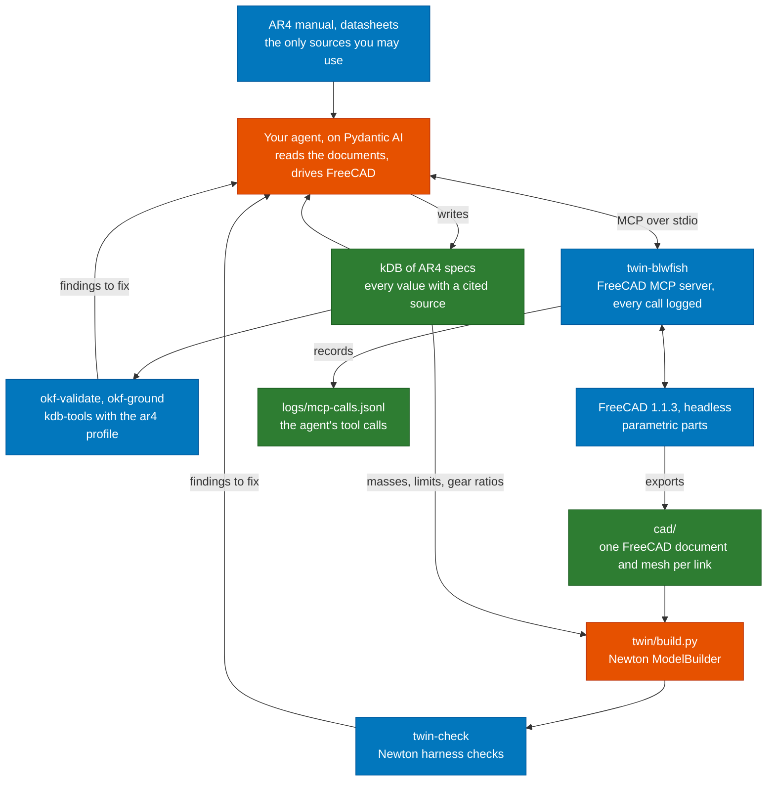

# AR4 digital twin

You build a simulation twin of the Annin Robotics AR4 arm from its documents alone. Your agent
reads the manual, the datasheets and Annin's spreadsheets into a kDB (Knowledge DB), in which
every number cites the sentence or spreadsheet cell that states it. It then models each link in
FreeCAD through MCP from those numbers. You assemble the links into a Newton model, and the model
has to pass the checks in this repository.

The [project page](https://aegean.ai/aiml-common/projects/robotics/ar4-digital-twin) describes
the task and how it is graded. This repository holds the environment, a starter for your agent,
and the tools that check your work. The course runs the same tools at grading time.

## Where the tools fit

Orange boxes are what you build. Blue boxes come from the course. Green boxes are what you
submit, along with your code.



The public AR4 URDF and Annin's CAD files are not sources. Your geometry comes from the
dimensions in the documents, and your masses come from material densities and datasheets.

The gripper is the one exception. You model Annin's servo gripper, described in Chapter 5 of the
AR4 MK4 robot manual v1.1. Its STEP files, in `AR4-Servo-Gripper-CAD.zip` in the
[Annin-Robotics/downloads](https://github.com/Annin-Robotics/downloads) repository, are a source
for the gripper only, because the manual does not give the gripper's dimensions. Measure what you
need on them, such as the jaw stroke, and cite the measurement in your kDB.

## Models and agents you may use

You build the agent yourself, in Python, with Pydantic AI. Commercial agent products and hosted
agent services, such as the ChatGPT, Claude or Gemini apps, Claude Code or a hosted agent
platform, are not accepted. Neither is a framework that runs its own agent to write the kDB or
drive FreeCAD.

The model behind your agent can come from one of three places:

1. A local OpenAI-compatible server with an open-weight model, such as Ollama, llama.cpp, vLLM,
   SGLang or LM Studio.
2. A free model on [OpenRouter](https://openrouter.ai/models), whose model ids end in `:free`.
   Free models are rate limited, so your runs are slower.
3. A paid model on OpenRouter, with a strict credit limit set on your API key before you start.

No other hosted model API is allowed. Keep your OpenRouter key in an environment variable, never
in a file you commit. The starter reads it from the variable named in `kdb.toml`.

## Set up

You need Docker. Build the project image once, from the repository root:

```bash
docker build -f docker/Dockerfile -t ar4-twin .
```

The image holds FreeCAD 1.1.3, the blwfish server, Newton 1.7.0 and the tools below, at pinned
versions. `docker/run.sh` runs any command in it with the repository mounted at `/work`. The
container's home directory is `.home/` and logs go to `logs/`. Both stay in your checkout, and git
ignores them.

## Run

Start your agent from `starter/`. It runs on your machine with uv and starts the FreeCAD server
through `docker/run.sh twin-blwfish`. Its README says what it already does and what is yours.

```bash
cd starter && cp kdb.toml.example kdb.toml && uv sync
uv run twin --kdb ../kdb --repo .. ingest ../kdb/documents/ar4-manual.pdf
uv run twin --kdb ../kdb --repo .. cad links/link-2.md
```

Check the kDB, the agent's FreeCAD calls and the twin:

```bash
docker/run.sh okf-validate kdb
docker/run.sh okf-ground kdb
docker/run.sh twin-mcp-log summary logs/mcp-calls.jsonl
docker/run.sh twin-sync                   # the FreeCAD documents in cad/ against the kDB
docker/run.sh twin-check twin/build.py
docker/run.sh twin-check twin/build.py --json   # a report your agent can read
```

Each check exits 0 when there are no errors, 1 when there are errors and 2 when it could not run.

## The kDB

The kDB is an OKF bundle in `kdb/`. Put the documents under `kdb/documents/` and the highlighted
copies of the PDFs under `kdb/annotated/`. Each part of the arm gets one page, and each page lists
its numbers under `quantities`:

```yaml
type: Joint
title: J2
parent: /links/link-1.md
child: /links/link-2.md
quantities:
  upper_limit: {value: 90, unit: deg, source: manual-p37-2}
  velocity_limit: {value: 180, unit: deg/s, formula: "6 * /motors/j2.md#max_speed / /gearboxes/j2.md#ratio"}
```

A quantity cites a source on its page or gives a formula over other quantities. A source is a
sentence in a PDF, or a spreadsheet cell cited by file, sheet and cell:

```yaml
sources:
  - {id: dh-d1, resource: /documents/ar4-dh.xlsx, sheet: DH, cell: C2, value: "150"}
```

The `ar4` profile checks the pages. Every quantity needs a number, a unit from `twin_tools.units`,
and a source or a formula. A formula is recomputed and must give the stated value. A Joint needs
its two limits, a velocity limit, an effort limit and its four DH quantities, and must connect
two Link pages. A Link names its Material page, a Material needs its density, a Gearbox its ratio,
and a Gripper its `jaw_stroke`, `jaw_force` and `jaw_speed` and a `material`.

`twin/build.py` reads every number with `twin_tools.kdb.si`, which converts it to SI units:

```python
from twin_tools.kdb import si
upper = si("joints/j2.md", "upper_limit")   # 90 deg on the page, 1.5708 rad here
```

A Joint states its row of Annin's DH table as `dh_theta_offset` and `dh_alpha` (angles) and
`dh_d` and `dh_a` (lengths). A zero still needs a unit and a source. The convention is standard
DH, as in Annin's spreadsheet: frame n is the frame of link n, joint n turns about the z axis of
frame n-1, and the world frame is frame 0. Link n's transform is
`A_n = Rz(theta_offset_n + q_n) Tz(d_n) Tx(a_n) Rx(alpha_n)`.

`twin_tools.dh` builds the frames from these rows. `dh.row("joints/j2.md")` reads a joint's row
with `si`, `dh.frames(rows, q)` returns `[T_00, T_01, ..., T_0n]` and `dh.axes(frames)` returns
the origin and unit z of frame n-1 for each joint n.

`twin-check` finds the arm's joints by their labels `J1` to `J6` and reads joint n's DH row from
`joints/j<n>.md`. For each pair of labeled joints J(n-1) and J(n), it checks the angle and the
distance between their axes against alpha and a of row n-1. When all six labels are present, it
also checks each axis against the frames the six rows give. A joint with any other label is not
checked. If any of `J1` to `J6` is missing, the full-chain check is skipped without a finding,
and the summary says `kinematics pairs only`.

## Train the skills

Once your twin passes `twin-check`, you build the pipeline that trains the `pick` and `place`
skills on it with PPO from rsl_rl, then chains them and judges the result. You train on your own
GPU or on Colab. Your skills must meet the interface in `src/twin_tools/skill.py`, and the task
constants are in `src/twin_tools/task.py`. The [pipeline guide](docs/pipeline-guide.md) covers
each part, with the settings, rewards and rsl_rl configuration that trained working skills on the
course's reference twin.

## Tools

| Tool | What it does |
|---|---|
| `twin-blwfish` | Starts the [blwfish FreeCAD MCP server](https://github.com/blwfish/freecad-mcp) (v8.4.0) on stdio behind the call logger. Point your agent's MCP configuration at it. |
| `twin-mcp-log` | `run` logs every message between an agent and a stdio MCP server. `summary` lists the tool calls in a log and marks the failed ones, including failures the server reports as successes. |
| `twin-check` | Loads `twin/build.py`, builds the Newton model and checks it: every link has mass, every joint has limits, an effort limit and a velocity limit, every one of those values and every shape density was read from the kDB, the gripper built alone matches the one on the arm, the axes of the joints labeled `J1` to `J6` follow the DH rows in the kDB, the arm released at rest under gravity stays finite and inside its limits, and the gripper holds the course cube. |
| `twin-sync` | Opens the FreeCAD documents in `cad/` with `freecadcmd` and compares them with the kDB: every spreadsheet reference names a quantity, every spreadsheet value matches it (in the assembly's sheet too, if it has one), every sketch constraint and pad length is bound to the spreadsheet, every STL matches its recomputed part, and every link sits at its DH frame in `cad/ar4.FCStd`. Run it in the container. |
| `okf-validate`, `okf-ground` | The [kdb-tools](https://github.com/aegean-ai/kdb-tools) checks, with the `ar4` profile's rules. `okf-ground` checks every source against its document. |

Newton accepts a joint with no limits and a link with no mass without complaint. It fills in
limits of 1e10 and effort and velocity limits of 1e6, gives an empty link a mass of 0 and a
shape with no density 1000 kg/m³. `twin-check` reports each of these. It also reports any limit,
density or mass that `build.py` typed in instead of reading from the kDB with
`twin_tools.kdb.si`. A value must match a read of the right kind: a revolute joint's limits,
effort limit and velocity limit come from an angle, a torque and an angular speed, a prismatic
joint's from a length, a force and a speed, a density from a density and a mass from a mass. A jaw's
closed limit of 0 needs no page. Findings on the gripper that `build_gripper()` builds end in
`(build_gripper)`. Use `--no-trace` while you develop, before your kDB has the values.

`build.py` also defines `build_gripper(builder)`, which builds the gripper alone with its base
fixed to the world and returns the grasp frame. The frame sits midway between the jaws' inner
faces and halfway along their contact length, with z pointing out of the gripper. The `gripper`
check builds it and compares its jaws, `JAW1` and `JAW2`, with the jaws on the arm. The `grasp`
check runs last, and only when every other check passed. It places a 25 mm, 50 g cube on the
grasp frame with the jaws open. Gravity pulls along the frame's z, out of the gripper. With the
jaws held open the cube must fall, which shows that nothing else holds it. Then the jaws close at
their effort limit. Once they are closed, neither jaw may sink more than 2 mm into the cube; the
summary reports the deeper one as `grasp_penetration_m`. Then the cube may slide at most 5 mm in
2 s. The check gives every shape of the gripper and the cube a friction coefficient of 0.8 and a
stiff contact, whatever your twin sets. That includes a finger or pad on a body welded to a jaw,
and such a shape counts toward its jaw's penetration. Use `--no-grasp` to skip it.

## Known issues with the FreeCAD server

blwfish v8.4.0 on FreeCAD 1.1.3 has these defects. Your agent will meet them, so it has to check
what it built instead of trusting the tool results.

- Many failures come back as a normal result whose text is `{"error": ...}`. `twin-mcp-log summary`
  counts these as failures, and the starter sends them back to the model.
- Some failures come back with no error at all, such as
  `{"result": "No active document. Call view_control(operation='create_document') first."}`.
- `execute_python` can return only a style tip while the code it ran had no effect. Assigning a
  new shape to a parametric object such as a `Part::Box` and then calling `recompute()` rebuilds the
  box from its own parameters, so a cut made that way disappears.
- `add_constraint` with an expression FreeCAD cannot resolve adds the constraint with value 0 and
  reports success.
- `add_rectangle` and `add_circle` add their own fixed size and position constraints. Your own
  constraints on top over-constrain the sketch. The features built on it then fail to compute,
  while `pocket` and `recompute` still report success and the measurement tools report the last
  valid shape.
- `varset_operations` with `add_property` ignores its `value`, so the property stays at 0. Set the
  value afterwards with `set_property` and read it back.
- `execute_python` can save the open document by itself, and the result then carries an `autosave`
  field. A value you changed only to test the part can end up in the saved file, so set it back
  and save again before you export.
- `get_mass_properties` fails because the Body's shape is a compound. Measure `Shape.Solids[0]`.
- Exports and saves work only under the home directory (`/work/.home` in the container) or `/tmp`.
- FreeCAD rejects spreadsheet aliases that are unit symbols, such as `W` or `T`.


## Keeping FreeCAD in sync

`twin-sync` finds the places where your FreeCAD documents have drifted from your kDB. Each link is
one document, `cad/<page stem>.FCStd`, with its mesh `cad/<page stem>.stl` beside it, for the page
`kdb/links/<page stem>.md`. The assembly is `cad/ar4.FCStd`. `twin-sync` reads only the
`.FCStd` files at the top of `cad/`, so it does not check the gripper's documents. Keep them in a
subdirectory, such as `cad/gripper/`, and check them against the kDB yourself.

Each link document has a spreadsheet labeled `kDB`. Row r holds three cells:

| Cell | Holds | Example |
|---|---|---|
| A | The quantity's reference | `/links/link-2.md#length` |
| B | Its value, with an alias | `280`, alias `length` |
| C | The value's unit, a key of `twin_tools.units` | `mm` |

The assembly may have a `kDB` spreadsheet too, for quantities it binds itself, such as the gripper's
`jaw_stroke`. `twin-sync` checks its rows the same way (`sync.ref` and `sync.value`). An assembly
with no `kDB` sheet is not a finding.

Column B holds a plain number in the unit of column C, and the sheet is read down to row 500. Bind
every sketch dimension and every feature size to an alias, as in the expression `kDB.length`, or
through a chain of expressions that ends at an alias, such as a pad length bound to a VarSet entry
that is bound to the sheet. Name the sheet object anything you like, but give it the label `kDB`.
A number typed into a sketch or a pad is a second copy of the kDB value, and the copy drifts.

The origin of a link's document is its DH frame. The base is frame 0, and the child link of
`joints/j<n>.md` is frame n. A link document whose stem is neither `base` nor the child of a joint
page is a finding. In `cad/ar4.FCStd`, place each link as an object whose label is the link page's
stem, such as `link-2`: a top-level object, or nested in a Part or Assembly. The check uses the
global placement. Once `cad/ar4.FCStd` exists, every link document in `cad/` must appear in it.

```bash
docker/run.sh twin-sync                   # reads cad/ and kdb/
docker/run.sh twin-sync cad --json        # a report your agent can read
```

| Rule | It reports |
|---|---|
| `sync.ref` | A cell in column A that names no kDB quantity, or a document with no `kDB` spreadsheet. |
| `sync.value` | A value in column B that differs from the kDB value, after conversion to SI, by more than 1e-9 relative. |
| `sync.free` | A sketch distance, radius, diameter or angle, or a Pad, Pocket, Revolution, Groove or primitive size, with no expression that reaches a `kDB` alias. |
| `sync.export` | An STL whose volume differs from the recomputed part by more than 0.5%. Export again after the kDB changes. The STL must be in millimetres. |
| `sync.frame` | A link whose placement in the assembly differs from its DH frame at q = 0 by more than 1e-6 m or 1e-6 rad, a link document missing from the assembly, or a link document with no DH frame. |
| `sync.load` | A document FreeCAD cannot open or recompute, or `freecadcmd` missing. |

The exit status is 0 when there are no findings, 1 when there are findings and 2 when the tool
could not run.
