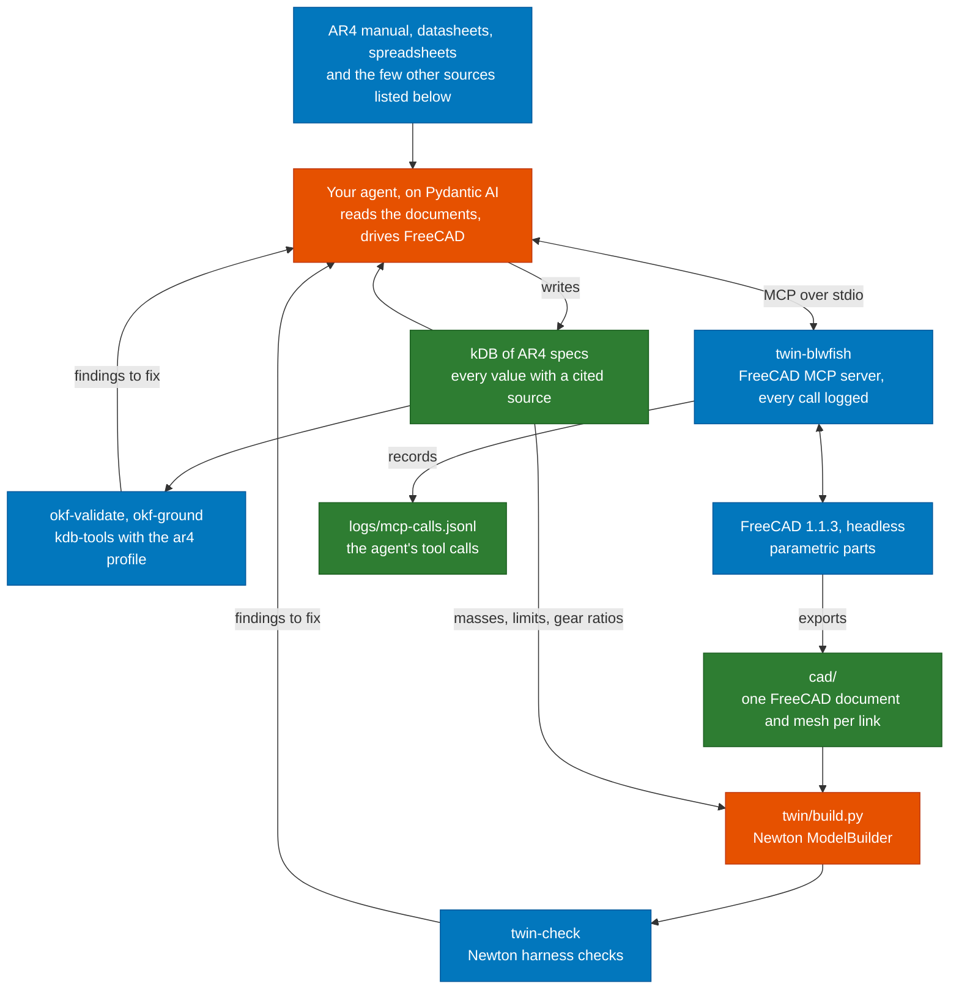

# AR4 digital twin

You build a simulation twin of the Annin Robotics AR4 arm using only its documents. Your agent
reads the manual, datasheets and Annin's spreadsheets into a kDB (Knowledge DB). Every number in
the kDB cites the sentence or spreadsheet cell that states it. Your agent then uses those numbers
to model each link in FreeCAD through MCP. You assemble the links into a Newton model. Your model
must pass the checks in this repository.

The [project page](https://aegean.ai/aiml-common/projects/robotics/ar4-digital-twin) describes
the task and its grading. This repository contains the environment, an agent starter and the
tools that check your work. At grading time, the course runs the checks listed in
[How the course grades](#how-the-course-grades).

## Where the tools fit

You build the orange boxes. The course provides the blue boxes. You submit the green boxes with
your code.



You cannot use the public AR4 URDF or Annin's CAD files as sources. You must get geometry from the
dimensions in the documents. You must get masses from material densities and datasheets.

You may also use two kinds of software as sources, only for the values named here:

| Source | You may cite it for |
|---|---|
| The lab's AR4 firmware, `annin_ar4_firmware/AR4_teensy/AR4_teensy.ino` in [aegean-ai/ar4_ros_driver](https://github.com/aegean-ai/ar4_ros_driver) | each joint's velocity limit (`JOINT_MAX_SPEED`) |
| The gripper driver: [ar4_ros_driver](https://github.com/ycheng517/ar4_ros_driver) (its gripper driver configuration and code, the gripper firmware `AR4_nano.ino`, and the jaw travel the driver reads as its closed and open positions, which is 14 mm in the driver's `ar_gripper_macro.xacro`) and the [Arduino Servo library](https://github.com/arduino-libraries/Servo) the firmware uses | the gripper's `jaw_force` and `jaw_speed`, and the values you compute them from |

Cite the file, commit and line or key, just as you cite a PDF page. You cannot use anything else
in these repositories as a source. Do not use the URDF or the driver's description package for
geometry, mass or inertia. You may use the jaw travel from that package only to compute
`jaw_force` and `jaw_speed`. You cannot use it to size the gripper.

The gripper is the one exception. You model Annin's servo gripper from Chapter 5 of the AR4 MK4 robot
manual v1.1. The manual does not give the gripper's dimensions. You may use the gripper STEP files in
`AR4-Servo-Gripper-CAD.zip` in the
[Annin-Robotics/downloads](https://github.com/Annin-Robotics/downloads) repository as a source
for the gripper only. Measure the dimensions you need, such as the jaw stroke. Cite each
measurement in your kDB.

## Models and agents you may use

You must build the agent yourself in Python with Pydantic AI. The course does not accept
commercial agent products or hosted agent services. These include the ChatGPT, Claude or Gemini
apps, Claude Code and hosted agent platforms. The course also does not accept a framework that
runs its own agent to write the kDB or drive FreeCAD.

You may get the model behind your agent from one of three places:

1. A local OpenAI-compatible server with an open-weight model, such as Ollama, llama.cpp, vLLM,
   SGLang or LM Studio.
2. A free model on [OpenRouter](https://openrouter.ai/models), whose model ids end in `:free`.
   Free models are rate limited, so your runs are slower.
3. A paid model on OpenRouter, with a strict credit limit set on your API key before you start.

You cannot use another hosted model API. Keep your OpenRouter key in an environment variable.
Never put it in a file you commit. The starter reads it from the variable named in `kdb.toml`.

## Set up

You need Docker. Build the project image once from the repository root:

```bash
docker build -f docker/Dockerfile -t ar4-twin .
```

The image contains FreeCAD 1.1.3, the blwfish server, Newton 1.7.0 and the tools below. Their
versions are pinned. `docker/run.sh` runs any command in the image with the repository mounted at
`/work`. The container uses `.home/` as its home directory and writes logs to `logs/`. Both
directories stay in your checkout. Git ignores them.

## Run

Start your agent from `starter/`. It runs on your machine with uv. It starts the FreeCAD server
through `docker/run.sh twin-blwfish`. Its README explains what it already does and what you need
to do.

```bash
cd starter && cp kdb.toml.example kdb.toml && uv sync
uv run twin --kdb ../kdb --repo .. ingest ../kdb/documents/ar4-manual.pdf
uv run twin --kdb ../kdb --repo .. cad links/link-2.md
```

Check the kDB, your agent's FreeCAD calls and the twin:

```bash
docker/run.sh okf-validate kdb
docker/run.sh okf-ground kdb
docker/run.sh twin-mcp-log summary logs/mcp-calls.jsonl
docker/run.sh twin-guisave               # save every document in cad/ once with GUI FreeCAD
docker/run.sh twin-sync                   # the FreeCAD documents in cad/ against the kDB
docker/run.sh twin-check twin/build.py
docker/run.sh twin-check twin/build.py --json   # a report your agent can read
```

Each check exits 0 when there are no errors. It exits 1 when there are errors. It exits 2 when it
could not run.

## The kDB

The kDB is an OKF bundle in `kdb/`. Put the documents under `kdb/documents/`. Put highlighted
copies of the PDFs under `kdb/annotated/`. Give each arm part one page. List its numbers under
`quantities`:

```yaml
type: Joint
title: J2
parent: /links/link-1.md
child: /links/link-2.md
quantities:
  upper_limit: {value: 90, unit: deg, source: manual-p37-2}
  velocity_limit: {value: 180, unit: deg/s, formula: "6 * /motors/j2.md#max_speed / /gearboxes/j2.md#ratio"}
```

Each quantity cites a source on its page or gives a formula that uses other quantities. A source
is a sentence in a PDF or a spreadsheet cell. Cite a spreadsheet cell by file, sheet and cell:

```yaml
sources:
  - {id: dh-d1, resource: /documents/ar4-dh.xlsx, sheet: DH, cell: C2, value: "150"}
```

Put values from the firmware or driver in a CSV file under `kdb/documents/`. Use one row for each
value. Include the file, commit and line or key for each value. Then cite the CSV cell in the
source, as in
`{id: j1-speed, resource: /documents/driver-values.csv, cell: B2, value: "60"}`.

The `ar4` profile checks the pages. Every quantity needs a number and a unit from
`twin_tools.units`. It also needs a source or a formula. The check recomputes each formula. The
result must match the stated value. A Joint needs its two limits, a velocity limit, an effort
limit and its four DH quantities. It must connect two Link pages. A Link names its Material page.
A Material needs its density. A Gearbox needs its ratio. A Gripper needs its `jaw_stroke`,
`jaw_force`, `jaw_speed` and `material`.

`twin/build.py` reads every number with `twin_tools.kdb.si`. This function converts each value to
SI units:

```python
from twin_tools.kdb import si
upper = si("joints/j2.md", "upper_limit")   # 90 deg on the page, 1.5708 rad here
```

A Joint states its row of Annin's DH table as `dh_theta_offset` and `dh_alpha` for angles, and
`dh_d` and `dh_a` for lengths. A zero still needs a unit and a source. Use standard DH, as in
Annin's spreadsheet. Frame n is the frame of link n. Joint n turns about the z axis of frame n-1.
The world frame is frame 0. Link n's transform is
`A_n = Rz(theta_offset_n + q_n) Tz(d_n) Tx(a_n) Rx(alpha_n)`.

`twin_tools.dh` builds the frames from these rows. `dh.row("joints/j2.md")` reads a joint's row
with `si`. `dh.frames(rows, q)` returns `[T_00, T_01, ..., T_0n]`. `dh.axes(frames)` returns the
origin and unit z of frame n-1 for each joint n.

`twin-check` finds the arm's joints by their labels `J1` to `J6`. It reads joint n's DH row from
`joints/j<n>.md`. For each pair of labeled joints J(n-1) and J(n), it checks the angle and
distance between their axes against alpha and a of row n-1. When all six labels are present, it
also checks each axis against the frames from the six rows. It does not check a joint with any
other label. If any label from `J1` to `J6` is missing, it skips the full-chain check without a
finding. The summary then says `kinematics pairs only`.

## Train the skills

After your twin passes `twin-check`, build the pipeline that trains the `pick` and `place` skills
on it with PPO from rsl_rl. Then chain the skills and judge the result. Train on your own GPU or
on Colab. Your skills must use the interface in `src/twin_tools/skill.py`. The task constants are
in `src/twin_tools/task.py`. The [pipeline guide](docs/pipeline-guide.md) covers each part. It
includes the settings, rewards and rsl_rl configuration that trained working skills on the
course's reference twin.

## How the course grades

The course grades your twin and your two skills together. It builds your twin from
`twin/build.py`. It loads your `pick` and `place` skills. It runs them in 512 worlds through the
course's pick-and-place environment. Your grade is the fraction of those episodes that succeed.
An episode succeeds when the cube rests in the box and the gripper is empty. Both conditions must
stay true for `HOLD_S` (0.5 s, 25 control steps in a row).

The plan is fixed: `pick`, then `place`. The grader runs `pick` until the cube has been held for
`HOLD_S`. It then hands the world to `place` at once. It restarts the arm targets and the last
action as the skill's start requires. Each action gets 5 s. The episode fails if a skill does not
reach its goal in that time. The episode also fails if the cube moves beyond 1 m of the base or
the world becomes non-finite. The judge decides every episode from the logged state. It does not
use claims from the executor.

You can estimate your grade with the practice seed. The constants are in
`src/twin_tools/task.py`: `EVAL_EPISODES` is 512, `ACTION_TIMEOUT_S` is 5.0, `HOLD_S` is 0.5 and
`PRACTICE_SEED` is 30000. Chain your skills as the [pipeline guide](docs/pipeline-guide.md)
describes. Use `PRACTICE_SEED` wherever the guide asks for a seed your training never used. Draw
512 episodes from it. Your chain is not the course's grader, so your estimate will not
match your grade exactly.

The course trained its own skills on other seeds. Keep `PRACTICE_SEED` out of your training seeds
too. Training a skill on the practice worlds makes your estimate too high.

The practice seed does not decide your grade. The course uses a different, unpublished seed for
evaluation. A skill that works only on the practice worlds loses points. The speed and
self-collision flags in a round's report are informational. They do not change a verdict or the
success rate.

Before each round, the course checks your submission. It refuses to grade your submission if any
of these checks reports an error, and it tells you why:

1. `okf-validate` on `kdb/` with the `ar4` profile. The grader checks the pages only and does not
   open a lake, so the `action.no-lake` warning does not matter.
2. `okf-ground` on `kdb/`.
3. `twin-sync` on `cad/` against `kdb/`.
4. `twin-check` on `twin/build.py`.
5. `check_skill` on your `pick` and `place` skill files.

Warnings do not cause the course to refuse a submission. The grader takes `twin/build.py`, `kdb/`
and `cad/ar4.FCStd` from your one repository. The round's record names that assembly. The grader
refuses a submission if `cad/ar4.FCStd` is missing. It also refuses one if `kdb/` or
`cad/ar4.FCStd` is a symlink to a place outside the repository. `twin-sync` compares only the
documents at the top of `cad/` with the kDB. Grading does not check the gripper's documents in
`cad/gripper/` against the kDB. Check them yourself. Run every check on your submission before
you hand it in.

## Tools

| Tool | What it does |
|---|---|
| `twin-blwfish` | Starts the [blwfish FreeCAD MCP server](https://github.com/blwfish/freecad-mcp) (v8.4.0) on stdio behind the call logger. Point your agent's MCP configuration at it. |
| `twin-mcp-log` | `run` logs every message between an agent and a stdio MCP server. `summary` lists the tool calls in a log and marks the failed ones, including failures the server reports as successes. |
| `twin-check` | Loads `twin/build.py`, builds the Newton model and checks it: every link has mass, every joint has limits, an effort limit and a velocity limit, every one of those values and every shape density was read from the kDB, the gripper built alone matches the one on the arm, the axes of the joints labeled `J1` to `J6` follow the DH rows in the kDB, the arm released at rest under gravity stays finite and inside its limits, and the gripper holds the course cube. |
| `twin-guisave` | Opens every `.FCStd` under `cad/`, `cad/gripper/` included, in GUI FreeCAD on a virtual display, shows the parts, gives each assembly joint its view provider, solves the assembly and saves. Run it in the container after every change to `cad/`. |
| `twin-sync` | Opens the FreeCAD documents in `cad/` with `freecadcmd` and compares them with the kDB: every spreadsheet reference names a quantity, every spreadsheet value matches it (in the assembly's sheet too, if it has one), every sketch constraint and pad length is bound to the spreadsheet, every STL matches its recomputed part, and every link sits at its DH frame in `cad/ar4.FCStd`. Run it in the container. |
| `okf-validate`, `okf-ground` | The [kdb-tools](https://github.com/aegean-ai/kdb-tools) checks, with the `ar4` profile's rules. `okf-ground` checks every source against its document. |

Newton accepts a joint with no limits and a link with no mass without complaint. It uses limits of
1e10 and effort and velocity limits of 1e6. It gives an empty link a mass of 0. It gives a shape
with no density 1000 kg/m³. `twin-check` reports each of these. It also reports any limit, density
or mass that `build.py` types in instead of reading from the kDB with `twin_tools.kdb.si`. The
check follows the exact number object that `si` returned. Pass that number to the builder
unchanged. It reports a typed number even if a read returned the same number. It also reports a
number computed from reads, such as a sum or ratio. If the twin needs a computed value, put it on
a kDB page as a formula quantity and read it. The read must come from the page and quantity that
the value belongs to. Joint `J<n>` reads `lower_limit`, `upper_limit`, `effort_limit` and
`velocity_limit` from `joints/j<n>.md`. A joint with another label reads them from a Joint page.
`JAW1` and `JAW2` read `jaw_stroke` for the open limit, `jaw_force` and `jaw_speed` from your
Gripper page. A shape on a body labeled like a link page, such as `link-2` for
`links/link-2.md`, takes its density from that link's Material page. Any other density must be a
quantity named `density` or ending in `_density`. Any other mass must be a quantity named `mass`
or ending in `_mass`. `twin-check` also reads each of these pages again from disk. Each value
must come from a read of the right kind. A revolute joint's limits, effort limit and velocity
limit come from an angle, torque and angular speed. A prismatic joint's values come from a
length, force and speed. A density comes from a density. A mass comes from a mass. A jaw's closed
limit of 0 needs no page. Findings for the gripper built by `build_gripper()` end in
`(build_gripper)`. Use `--no-trace` while you develop, before your kDB has the values.

`build.py` also defines `build_gripper(builder)`. It builds the gripper alone with its base fixed
to the world and returns the grasp frame. The frame sits midway between the jaws' inner faces. It
also sits halfway along their contact length. Its z axis points out of the gripper. The `gripper`
check builds it and compares its jaws, `JAW1` and `JAW2`, with the jaws on the arm. The `grasp`
check runs last. It runs only when every other check has passed. It places a 25 mm, 50 g cube on
the grasp frame with the jaws open. Gravity pulls along the frame's z axis and out of the
gripper. The cube must fall while the jaws are held open. This confirms that nothing else holds
it. The jaws then close at their effort limit. After they close, neither jaw may sink more than
2 mm into the cube. The summary reports the deeper jaw as `grasp_penetration_m`. The cube may
then slide at most 5 mm in 2 s. The check gives every gripper shape and the cube a friction
coefficient of 0.8 and a stiff contact, regardless of your twin's settings. This includes a
finger or pad on a body welded to a jaw. Such a shape counts toward that jaw's penetration. Use
`--no-grasp` to skip this check.

## Known issues with the FreeCAD server

blwfish v8.4.0 on FreeCAD 1.1.3 has these defects. Your agent will encounter them. It must check
what it built instead of trusting the tool results.

- Many failures come back as a normal result whose text is `{"error": ...}`. `twin-mcp-log summary`
  counts these as failures, and the starter sends them back to the model.
- Some failures come back with no error at all, such as
  `{"result": "No active document. Call view_control(operation='create_document') first."}`.
- `execute_python` can return only a style tip while the code it ran had no effect. Assigning a
  new shape to a parametric object such as a `Part::Box` and then calling `recompute()` rebuilds the
  box from its own parameters, so a cut made that way disappears.
- `add_constraint` with an expression FreeCAD cannot resolve adds the constraint with value 0 and
  reports success.
- `add_rectangle` and `add_circle` add their own fixed size and position constraints. Your own
  constraints on top over-constrain the sketch. The features built on it then fail to compute,
  while `pocket` and `recompute` still report success and the measurement tools report the last
  valid shape.
- `varset_operations` with `add_property` ignores its `value`, so the property stays at 0. Set the
  value afterwards with `set_property` and read it back.
- `execute_python` can save the open document by itself, and the result then carries an `autosave`
  field. A value you changed only to test the part can end up in the saved file, so set it back
  and save again before you export.
- `get_mass_properties` fails because the Body's shape is a compound. Measure `Shape.Solids[0]`.
- Exports and saves work only under the home directory (`/work/.home` in the container) or `/tmp`.
- FreeCAD rejects spreadsheet aliases that are unit symbols, such as `W` or `T`.


## Keeping FreeCAD in sync

`twin-sync` finds where your FreeCAD documents have drifted from your kDB. Give each link one
document named `cad/<page stem>.FCStd`. Put its mesh at `cad/<page stem>.stl`. These files
correspond to the page `kdb/links/<page stem>.md`. The assembly is `cad/ar4.FCStd`. `twin-sync`
compares only the `.FCStd` files at the top of `cad/` with the kDB. It does not check the
gripper's documents against the kDB. Keep them in a subdirectory such as `cad/gripper/`. Check
them against the kDB yourself.

After each change, save every document in `cad/` once with GUI FreeCAD by running
`docker/run.sh twin-guisave`. The FreeCAD MCP server saves without the GUI. GUI FreeCAD then
opens the parts hidden and the joints without markers. `twin-sync` reports any document under
`cad/` that was not saved this way as `sync.gui`. Grading refuses it.

Each link document has a spreadsheet labeled `kDB`. Row r contains three cells:

| Cell | Holds | Example |
|---|---|---|
| A | The quantity's reference | `/links/link-2.md#length` |
| B | Its value, with an alias | `280`, alias `length` |
| C | The value's unit, a key of `twin_tools.units` | `mm` |

The assembly may also have a `kDB` spreadsheet for quantities it binds itself, such as the
gripper's `jaw_stroke`. `twin-sync` checks its rows in the same way with `sync.ref` and
`sync.value`. An assembly with no `kDB` sheet does not produce a finding.

Column B contains a plain number in the unit from column C. The tool reads the sheet through row
500. Bind every sketch dimension and feature size to an alias, as in the expression `kDB.length`.
You may also use a chain of expressions that ends at an alias, such as a pad length bound to a
VarSet entry that is bound to the sheet. You may give the sheet object any name. Give it the
label `kDB`. A number typed into a sketch or pad is a second copy of the kDB value. That copy can
drift.

The origin of a link's document is its DH frame. The base is frame 0. The child link of
`joints/j<n>.md` is frame n. A link document produces a finding if its stem is neither `base` nor
the child of a joint page. In `cad/ar4.FCStd`, place each link as an object whose label is the
link page's stem, such as `link-2`. It can be a top-level object or be nested in a Part or
Assembly. The check uses its global placement. After `cad/ar4.FCStd` exists, every link document
in `cad/` must appear in it.

```bash
docker/run.sh twin-sync                   # reads cad/ and kdb/
docker/run.sh twin-sync cad --json        # a report your agent can read
```

| Rule | It reports |
|---|---|
| `sync.ref` | A cell in column A that names no kDB quantity, or a document with no `kDB` spreadsheet. |
| `sync.value` | A value in column B that differs from the kDB value, after conversion to SI, by more than 1e-9 relative. |
| `sync.free` | A sketch distance, radius, diameter or angle, or a Pad, Pocket, Revolution, Groove or primitive size, with no expression that reaches a `kDB` alias. |
| `sync.export` | An STL whose volume differs from the recomputed part by more than 0.5%. Export again after the kDB changes. The STL must be in millimetres. |
| `sync.frame` | A link whose placement in the assembly differs from its DH frame at q = 0 by more than 1e-6 m or 1e-6 rad, a link document missing from the assembly, or a link document with no DH frame. |
| `sync.load` | A document FreeCAD cannot open or recompute, or `freecadcmd` missing. |
| `sync.gui` | A document anywhere under `cad/`, `cad/gripper/` included, saved without the GUI (it has no `GuiDocument.xml`), or an assembly joint with no view provider or hidden. Run `twin-guisave`. |

The exit status is 0 when there are no findings. It is 1 when there are findings. It is 2 when
the tool could not run.