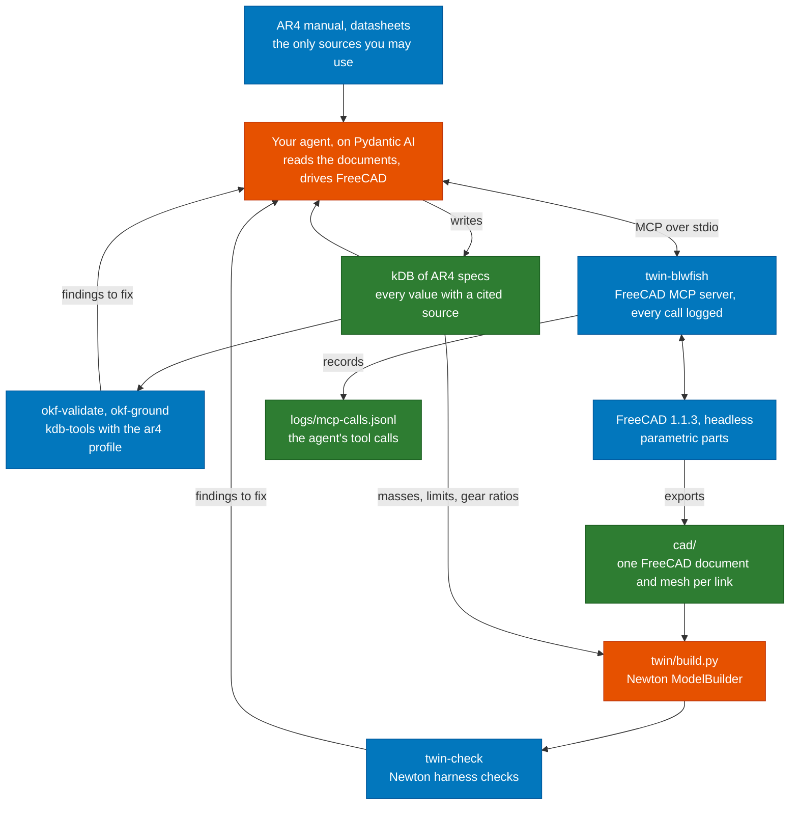

# AR4 digital twin

You build a simulation twin of the Annin Robotics AR4 arm from its documents alone. Your agent
reads the manual, the datasheets and Annin's spreadsheets into a kDB (Knowledge DB), in which
every number cites the sentence or spreadsheet cell that states it. It then models each link in
FreeCAD through MCP from those numbers. You assemble the links into a Newton model, and the model
has to pass the checks in this repository.

The [project page](https://aegean.ai/aiml-common/projects/robotics/ar4-digital-twin) describes
the task and how it is graded. This repository holds the environment, a starter for your agent,
and the tools that check your work. The course runs the same tools at grading time.

## Where the tools fit

Orange boxes are what you build. Blue boxes come from the course. Green boxes are what you
submit, along with your code.



The public AR4 URDF and Annin's CAD files are not sources. Your geometry comes from the
dimensions in the documents, and your masses come from material densities and datasheets.

## Models and agents you may use

You build the agent yourself, in Python, with Pydantic AI. Commercial agent products and hosted
agent services, such as the ChatGPT, Claude or Gemini apps, Claude Code or a hosted agent
platform, are not accepted. Neither is a framework that runs its own agent to write the kDB or
drive FreeCAD.

The model behind your agent can come from one of three places:

1. A local OpenAI-compatible server with an open-weight model, such as Ollama, llama.cpp, vLLM,
   SGLang or LM Studio.
2. A free model on [OpenRouter](https://openrouter.ai/models), whose model ids end in `:free`.
   Free models are rate limited, so your runs are slower.
3. A paid model on OpenRouter, with a strict credit limit set on your API key before you start.

No other hosted model API is allowed. Keep your OpenRouter key in an environment variable, never
in a file you commit. The starter reads it from the variable named in `kdb.toml`.

## Set up

You need Docker. Build the project image once, from the repository root:

```bash
docker build -f docker/Dockerfile -t ar4-twin .
```

The image holds FreeCAD 1.1.3, the blwfish server, Newton 1.7.0 and the tools below, at pinned
versions. `docker/run.sh` runs any command in it with the repository mounted at `/work`. The
container's home directory is `.home/` and logs go to `logs/`. Both stay in your checkout, and git
ignores them.

## Run

Start your agent from `starter/`. It runs on your machine with uv and starts the FreeCAD server
through `docker/run.sh twin-blwfish`. Its README says what it already does and what is yours.

```bash
cd starter && cp kdb.toml.example kdb.toml && uv sync
uv run twin --kdb ../kdb --repo .. ingest ../kdb/documents/ar4-manual.pdf
uv run twin --kdb ../kdb --repo .. cad links/link-2.md
```

Check the kDB, the agent's FreeCAD calls and the twin:

```bash
docker/run.sh okf-validate kdb
docker/run.sh okf-ground kdb
docker/run.sh twin-mcp-log summary logs/mcp-calls.jsonl
docker/run.sh twin-check twin/build.py
docker/run.sh twin-check twin/build.py --json   # a report your agent can read
```

Each check exits 0 when there are no errors, 1 when there are errors and 2 when it could not run.

## The kDB

The kDB is an OKF bundle in `kdb/`. Put the documents under `kdb/documents/` and the highlighted
copies of the PDFs under `kdb/annotated/`. Each part of the arm gets one page, and each page lists
its numbers under `quantities`:

```yaml
type: Joint
title: J2
parent: /links/link-1.md
child: /links/link-2.md
quantities:
  upper_limit: {value: 90, unit: deg, source: manual-p37-2}
  velocity_limit: {value: 180, unit: deg/s, formula: "6 * /motors/j2.md#max_speed / /gearboxes/j2.md#ratio"}
```

A quantity cites a source on its page or gives a formula over other quantities. A source is a
sentence in a PDF, or a spreadsheet cell cited by file, sheet and cell:

```yaml
sources:
  - {id: annin-dh-c2, resource: /documents/ar4-dh.xlsx, sheet: DH, cell: C2, value: "169.77"}
```

The `ar4` profile checks the pages. Every quantity needs a number, a unit from `twin_tools.units`,
and a source or a formula. A formula is recomputed and must give the stated value. A Joint needs
its two limits, a velocity limit and an effort limit, and must connect two Link pages. A Link
names its Material page, a Material needs its density and a Gearbox its ratio.

`twin/build.py` reads every number with `twin_tools.kdb.si`, which converts it to SI units:

```python
from twin_tools.kdb import si
upper = si("joints/j2.md", "upper_limit")   # 90 deg on the page, 1.5708 rad here
```

## Tools

| Tool | What it does |
|---|---|
| `twin-blwfish` | Starts the [blwfish FreeCAD MCP server](https://github.com/blwfish/freecad-mcp) (v8.4.0) on stdio behind the call logger. Point your agent's MCP configuration at it. |
| `twin-mcp-log` | `run` logs every message between an agent and a stdio MCP server. `summary` lists the tool calls in a log and marks the failed ones, including failures the server reports as successes. |
| `twin-check` | Builds the Newton model from `twin/build.py` and checks it: every link has mass, every joint has limits, an effort limit and a velocity limit, each of those values and every density was read from the kDB, and the arm released at rest under gravity stays finite and inside its limits. Use `--no-trace` while your kDB is still missing values. |
| `okf-validate`, `okf-ground` | The [kdb-tools](https://github.com/aegean-ai/kdb-tools) checks, with the `ar4` profile's rules. `okf-ground` checks every source against its document. |

Newton accepts a joint with no limits and a link with no mass without complaint. It fills in
limits of 1e10, effort and velocity limits of 1e6, a mass of 0 and a density of 1000 kg/m³.
`twin-check` reports each of these.

## Known issues with the FreeCAD server

blwfish v8.4.0 on FreeCAD 1.1.3 has these defects. Your agent will meet them, so it has to check
what it built instead of trusting the tool results.

- Many failures come back as a normal result whose text is `{"error": ...}`. `twin-mcp-log summary`
  counts these as failures, and the starter sends them back to the model.
- Some failures come back with no error at all, such as
  `{"result": "No active document. Call view_control(operation='create_document') first."}`.
- `execute_python` can return only a style tip while the code it ran had no effect. Assigning a
  new shape to a parametric object such as a `Part::Box` and then calling `recompute()` rebuilds the
  box from its own parameters, so a cut made that way disappears.
- `add_constraint` with an expression FreeCAD cannot resolve adds the constraint with value 0 and
  reports success.
- `add_rectangle` and `add_circle` add their own fixed size and position constraints. Your own
  constraints on top over-constrain the sketch. The features built on it then fail to compute,
  while `pocket` and `recompute` still report success and the measurement tools report the last
  valid shape.
- `varset_operations` with `add_property` ignores its `value`, so the property stays at 0. Set the
  value afterwards with `set_property` and read it back.
- `execute_python` can save the open document by itself, and the result then carries an `autosave`
  field. A value you changed only to test the part can end up in the saved file, so set it back
  and save again before you export.
- `get_mass_properties` fails because the Body's shape is a compound. Measure `Shape.Solids[0]`.
- Exports and saves work only under the home directory (`/work/.home` in the container) or `/tmp`.
- FreeCAD rejects spreadsheet aliases that are unit symbols, such as `W` or `T`.
