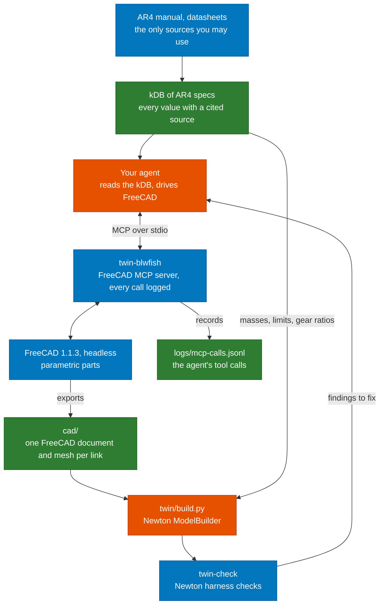

# AR4 digital twin

Student project for Robotics. You build a simulation twin of the Annin Robotics AR4 arm from
its documents alone: the manual, the motor and gearbox datasheets, and anything else your agent
can find and cite. An AI agent models each link in FreeCAD through MCP, you assemble the links
into a Newton model, and the model has to pass the checks in this repository. The project page
on aegean.ai describes the task and how it is graded.

This repository holds the environment and the tools that check your work. The course runs the
same tools at grading time.

## Where the tools fit

Orange boxes are what you build. Blue boxes come from the course. Green boxes are what you
submit, along with your code.



The public AR4 URDF and Annin's CAD files are not sources for this project. Your geometry comes
from the dimensions in the documents, and your masses come from material densities and datasheets.

## Tools

| Tool | What it does |
|---|---|
| `twin-blwfish` | Starts the [blwfish FreeCAD MCP server](https://github.com/blwfish/freecad-mcp) (v8.4.0) on stdio behind the call logger. Point your agent's MCP configuration at it. |
| `twin-mcp-log` | `run` logs every message between an agent and any stdio MCP server. `summary` lists the tool calls in a log and marks which ones failed, including failures the server reports as successes. Both exit 2 when they cannot run. |
| `twin-check` | Loads `twin/build.py`, builds the Newton model and checks it: every link has mass, every joint has limits, an effort limit and a velocity limit, and the arm released at rest under gravity stays finite and inside its limits. |

Newton accepts a joint with no limits and a link with no mass without complaint. It fills in
limits of 1e10 and effort and velocity limits of 1e6, and gives an empty link a mass of 0.
`twin-check` reports each of these, because every one of those values belongs in your kDB.

## Set up

You need Docker. Build the project image once, from the repository root:

```bash
docker build -f docker/Dockerfile -t ar4-twin .
```

The image holds FreeCAD 1.1.3, the blwfish server, Newton 1.7.0 and these tools, all at pinned
versions. `docker/run.sh` runs any command in it with the repository mounted at `/work`. Files the
tools write stay in your checkout: the container's home directory is `.home/` and logs go to
`logs/`, and git ignores both.

## Run

Check your twin:

```bash
docker/run.sh twin-check twin/build.py
docker/run.sh twin-check twin/build.py --json   # a report your agent can read
```

The exit status is 0 when there are no errors, 1 when there are errors and 2 when the tool could
not run.

Give your agent the FreeCAD server. With Claude Code, for example:

```bash
claude mcp add freecad -- docker/run.sh twin-blwfish
```

Start a headless FreeCAD from the agent with the server's `spawn_freecad_instance` tool. Then
read back what the agent did:

```bash
docker/run.sh twin-mcp-log summary logs/mcp-calls.jsonl
```

## Known issues with the FreeCAD server

These are defects in blwfish v8.4.0 on FreeCAD 1.1.3, found while preparing the project. Your agent
will meet them, so it has to check what it built rather than trust the tool results.

- Many failures come back as a normal result whose text is `{"error": ...}`. `twin-mcp-log summary`
  counts these as failures.
- `add_constraint` with an expression FreeCAD cannot resolve still adds the constraint, with value 0,
  and reports success.
- `add_rectangle` and `add_circle` add their own fixed-value size and position constraints. Adding
  your own on top makes the sketch over-constrained. The features built on it then fail to compute,
  while `pocket` and `recompute` still report success and the measurement tools report the last
  valid shape.
- `get_mass_properties` fails because the Body's shape is a compound. Measure `Shape.Solids[0]` instead.
- Exports and saves work only under the home directory (`/work/.home` in the container) or `/tmp`.
- FreeCAD rejects spreadsheet aliases that are unit symbols, such as `W` or `T`.

## Develop

```bash
uv sync
uv run pytest                                              # the logger tests; the twin-check tests skip without Newton
docker/run.sh env PYTHONPATH=/work/src python -m pytest   # everything, in the container
```
